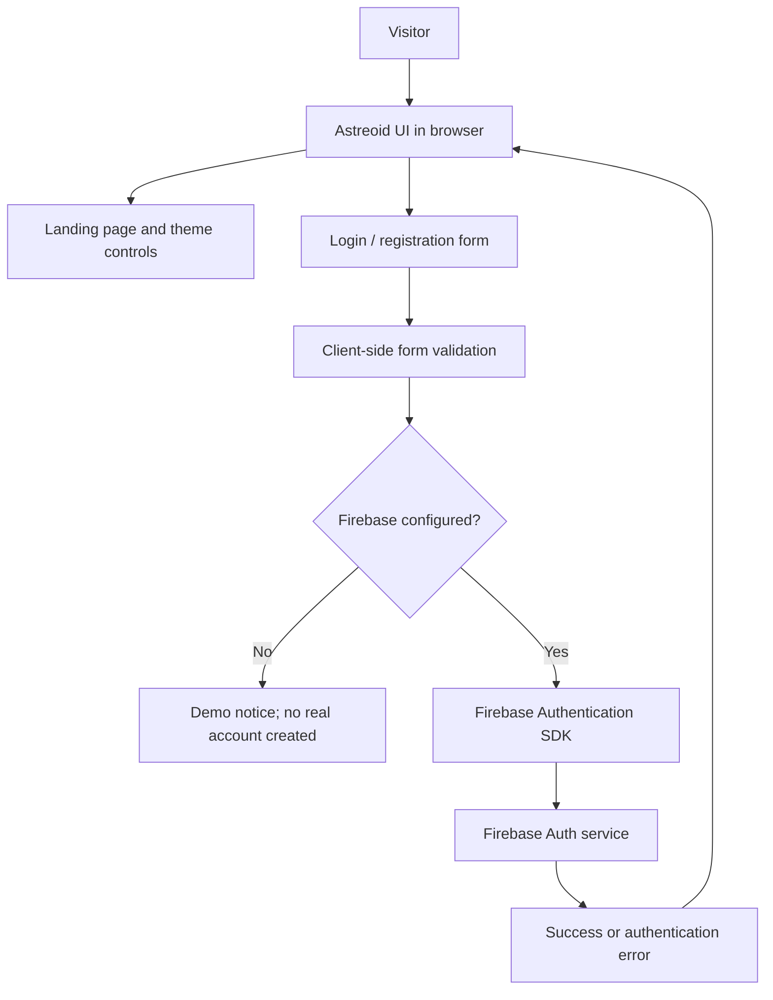
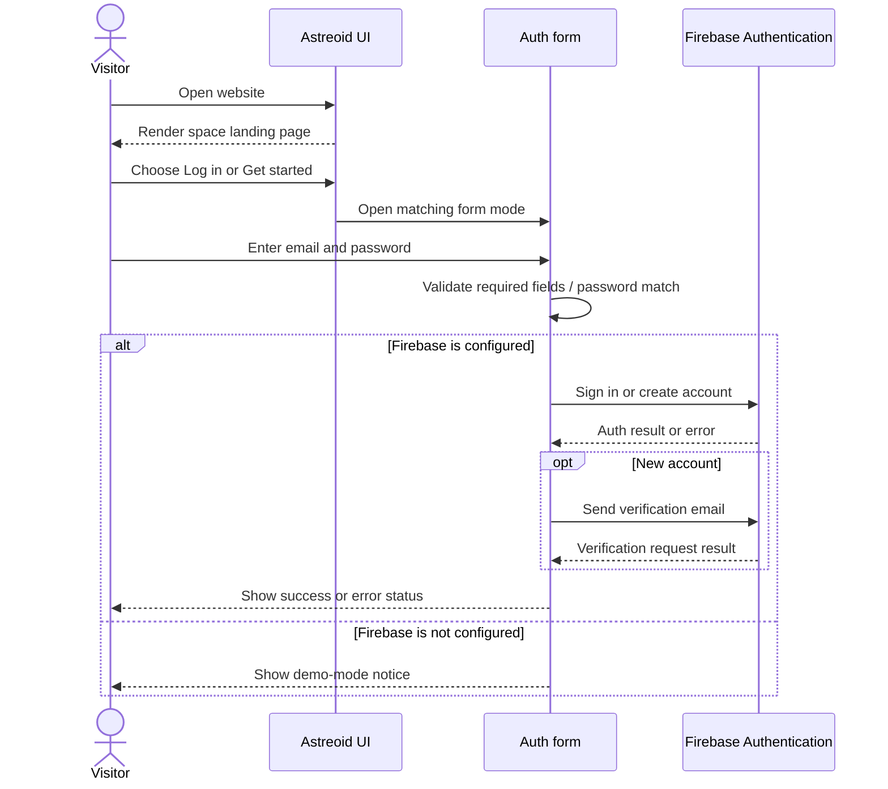

✦ ASTREOID
Explore beyond. Stay curious.
A 3D-inspired space exploration experience with Firebase-powered authentication.

Features · Architecture · Workflow · Installation · Firebase setup · Screenshots · Troubleshooting

🌌 About the project
Astreoid is a responsive, space-themed website built around an animated cosmic landing page and a simple account sign-in/sign-up experience. The interface uses a dark starfield aesthetic, a CSS 3D-style planet with orbital rings, and a day/night theme toggle. Firebase Authentication can be configured to handle real email/password accounts and email verification.
Project status: The supplied project materials include a working HTML preview/starter and Firebase setup screenshots. Configure your own Firebase project before treating authentication as production-ready. A live deployment URL was not included in the supplied files.

✨ Features
- Cosmic landing page — animated starfield, planet, orbit rings, moon, and satellite illustrations.
- Responsive layout — navigation, hero, discovery cards, mission section, and call-to-action adapt to smaller screens.
- Day/night theme — switch the page between the default night theme and a brighter day theme.
- Login and registration UI — switch between sign-in and create-account modes.
- Form validation — checks required fields and confirms that registration passwords match.
- Firebase Authentication integration — supports email/password registration and login when configured with your Firebase web app.
- Email verification — registration can send a verification email through Firebase.
- Demo mode — the preview explains when Firebase is not configured; demo mode must not be mistaken for real account authentication.
- Accessible interaction basics — labelled controls and semantic buttons/sections are used in the supplied starter.
🧰 Technology stack
Technology	Purpose
HTML, CSS, JavaScript	Website structure, responsive styling, animations, and interactions in the supplied starter
CSS animations and gradients	Planet/orbit effects and the space-themed visual system
Firebase Authentication	Email/password sign-in, account creation, and email verification
Firebase Web SDK	Connects the browser application to Firebase services
Vite + React (if using the newer app workspace)	Development server and component-based frontend; use the commands matching that workspace's package.json

Repository note: The ZIP available with the project contains index.html, firebase-config.example.js, and a starter README. If your current working copy is the newer Vite/React workspace, keep its existing package.json and src/ structure; the environment-variable instructions below apply to that setup. The exact package scripts should be confirmed in that workspace's package.json.
🏗️ Architecture

Main components
- Presentation layer: page sections, responsive layout, visual effects, and theme toggle.
- Authentication interface: login/register modal and client-side validation.
- Firebase integration: initializes the Firebase app and exposes the Authentication instance and required auth functions to the page (in the supplied HTML starter).
- Firebase Console: owns project configuration and the Email/Password sign-in provider setting.
Firebase web configuration identifies your Firebase project; it is not a substitute for security rules or server-side authorization. Never place service-account credentials, private keys, or email-provider secrets in frontend code.
🔄 Working flow

User journey
1. Open the landing page and explore the sections.
2. Use the theme control to toggle day/night styling.
3. Select Log in for an existing account or Get started to register.
4. Enter an email and password. Registration also asks for password confirmation.
5. With Firebase configured, the app sends the request to Firebase Authentication.
6. After registration, check the inbox for the Firebase verification email.
7. If authentication fails, read the status shown in the form and check the configuration steps below.
📁 Project structure
Supplied static starter archive
astreoid/
├── index.html                    # Landing page, styles, interactions, auth UI
├── firebase-config.example.js    # Firebase SDK setup template
└── README.md                     # Starter notes
Newer Vite/React workspace (if this is the copy you are running)
astreoid/
├── public/                       # Static public assets (if present)
├── src/                          # React components and application code
├── .env                          # Local Firebase environment values (do not commit)
├── .gitignore
├── index.html
├── package.json
├── vite.config.js
└── README.md
The second tree is a typical layout based on the Vite workspace described during setup; keep the actual files and names in your working repository if they differ.
🚀 Installation
Option A — run the supplied HTML starter
Requirements: a modern browser and a local web server for Firebase modules. Opening the file directly with a file:// URL is not recommended for authentication setup.
1. Download or clone the repository and extract the project folder.
2. Open the folder in VS Code.
3. Start a local server, for example with the Live Server extension.
4. Open the local URL printed by the server.
5. The visual preview can be explored before Firebase is configured; real account creation and login require the Firebase steps below.
Option B — run the Vite/React workspace
From the folder containing package.json, run:
npm install
npm run dev
Open the local URL printed by Vite (commonly http://localhost:5173). To create a production build, run:
npm run build
npm run preview
If npm run dev or npm run build is not defined, inspect the scripts section of package.json and use the scripts provided by your project. Do not run these commands from the static starter folder unless it contains a package.json.
🔐 Firebase Authentication setup
1. Create or select a Firebase project
Open the Firebase Console and select the Astreoid project (or create a new project for your own deployment).
2. Register a web app
In Project settings → General → Your apps, register a Web app and copy its Firebase configuration. The screenshots below are the actual Firebase Console screenshots supplied with the project materials.

3. Enable Email/Password sign-in
In Firebase Console, open Authentication → Sign-in method (the exact menu labels may vary slightly) and enable Email/Password. Save the setting.
4. Configure environment variables for Vite/React
Create a .env file in the Vite project root (next to package.json). Use your own values from Firebase Project settings:
VITE_FIREBASE_API_KEY=your_firebase_web_api_key
VITE_FIREBASE_AUTH_DOMAIN=your-project-id.firebaseapp.com
VITE_FIREBASE_PROJECT_ID=your-project-id
VITE_FIREBASE_APP_ID=your_firebase_app_id
Do not paste actual project values into this README or commit .env to a public repository. Vite only exposes environment variables prefixed with VITE_ to client-side code. These values are therefore visible to users in the built frontend; protect your project with Firebase Authentication settings, authorized domains, appropriate security rules, and usage restrictions. Never add service-account credentials or private secrets to VITE_* variables.

Read the values in the frontend using the exact names, for example:
const firebaseConfig = {
  apiKey: import.meta.env.VITE_FIREBASE_API_KEY,
  authDomain: import.meta.env.VITE_FIREBASE_AUTH_DOMAIN,
  projectId: import.meta.env.VITE_FIREBASE_PROJECT_ID,
  appId: import.meta.env.VITE_FIREBASE_APP_ID,
};
Restart the Vite development server after changing .env values.
5. Configure the supplied static starter instead
If using the ZIP's plain HTML starter rather than Vite/React:
1. Copy firebase-config.example.js to firebase-config.js.
2. Replace every YOUR_... placeholder with the values from your own Firebase web app.
3. Add the following module script immediately before </body> in index.html:
   
4. Serve the folder using a local web server, then test registration and login.
The static starter's example config imports the Firebase Web SDK and exposes the auth instance/functions used by its form. The Vite/React workspace may initialize Firebase differently; do not add the static starter's global variables unless its code expects them.
6. Check the Firebase project settings

- Make sure the API key, auth domain, project ID, and app ID all belong to the same Firebase web app.
- Add your local and production domains under Authentication → Settings → Authorized domains, where required.
- Use Firebase Console's current instructions if its UI differs from these screenshots.
🖼️ Screenshots
The following are actual screenshots from the available project files and show the Firebase setup process:
Screenshot	What it shows
	Firebase Console's web app registration / setup flow
	Firebase setup instructions and app configuration flow
	Firebase project settings navigation

Homepage screenshot: the available uploaded screenshots did not include a capture of the rendered Astreoid landing page or authentication modal, so no mock screenshot is presented as if it were real. Once the app is running, capture the browser view and add it to assets/astreoid-homepage.png, then include it here:

For a stronger project showcase, capture the homepage in night mode, the day mode, the login modal, the registration form, and the mobile layout. Do not include screenshots containing API keys, passwords, email addresses, or other private configuration values.
🧪 Testing checklist
- [ ] Landing page loads without console errors.
- [ ] Navigation links scroll to the expected sections.
- [ ] Day/night toggle changes the theme.
- [ ] Login and registration modes switch correctly.
- [ ] Empty required fields are rejected.
- [ ] Registration rejects mismatched passwords.
- [ ] Firebase Email/Password provider is enabled.
- [ ] A test account can be registered using an email you control.
- [ ] Verification email arrives and the verification link works.
- [ ] Login succeeds for a valid account and shows a useful error for invalid credentials.
- [ ] Layout works on desktop and mobile widths.
- [ ] Production build completes and deployed authorized domains are configured.
🛠️ Troubleshooting
auth/api-key-not-valid or auth/invalid-api-key
- Confirm VITE_FIREBASE_API_KEY is the Web API key from the correct Firebase project.
- Check for missing quotes, accidental spaces, misspelled variable names, or an empty .env value.
- Confirm your code reads import.meta.env.VITE_FIREBASE_API_KEY exactly.
- Restart npm run dev after editing .env.
- Verify all Firebase config values belong to the same project. Never use a placeholder value.
import.meta.env values are undefined
- Ensure .env is in the project root, beside package.json and vite.config.js.
- Ensure each browser-exposed variable starts with VITE_.
- Restart Vite after changes.
- Remember that .env.local may override values depending on your local setup; inspect the files you use.
Firebase login or registration fails
- Enable Email/Password in Firebase Authentication sign-in providers.
- Check the browser console and the message in the auth form.
- Confirm the API key, auth domain, project ID, and app ID match the same Firebase web app.
- Confirm the current site domain is allowed in Firebase Authentication's authorized domains.
- Use a local HTTP server rather than opening the static HTML with file://.
Verification email does not arrive
- Check spam/junk folders and confirm the address was typed correctly.
- Check Firebase Authentication user records and email template/settings.
- Try a fresh test account and check Firebase's current email-sending limits.
- Do not claim email verification is complete until the user follows the verification link.
Changes to .env do not appear
- Stop and restart the Vite development server.
- Confirm you edited the .env file in the active project folder, not another copy.
- Check for duplicate .env files and spelling differences.
npm run dev fails
- Run npm install in the folder containing package.json.
- Check Node.js/npm installation with node --version and npm --version.
- Confirm the dev script exists in package.json.
- If you are using only the supplied static starter, use a local web server instead of Vite commands.
🔒 Security and deployment notes
- Never commit .env, passwords, service-account JSON, private keys, or email-provider secrets.
- A Firebase web API key is not a password, but it is still project configuration: restrict it appropriately and use Firebase's recommended protections.
- Configure authorized domains before deployment.
- Use Firebase Security Rules for any Firebase database or storage services you add; authentication alone does not secure application data.
- Test the production build and authentication flow on the deployed domain.
- Do not claim that the website is deployed until a real deployment URL is available and verified.
🚢 Deployment overview
For a Vite/React build:
1. Configure production environment values in your hosting provider.
2. Run npm run build and confirm the output directory (commonly dist/).
3. Deploy that output directory using Firebase Hosting or another static host.
4. Add the production domain to Firebase Authentication's authorized domains.
5. Test registration, verification, login, logout (if implemented), and error states on the deployed site.
For Firebase Hosting, follow the official Firebase Hosting documentation. The exact deployment steps depend on whether your active project is the static HTML starter or the newer Vite/React workspace.
🗺️ Roadmap ideas
- Add a real planet/exploration detail page and richer interactive space objects.
- Add account profile and sign-out state if not already implemented in the active app.
- Add automated UI and authentication tests.
- Improve reduced-motion support and keyboard focus visibility.
- Add deployment preview links and fresh screenshots to this README.
🤝 Contributing
1. Create a branch for your change.
2. Keep UI components responsive and accessible.
3. Never commit real credentials or personal test-account data.
4. Test both configured-auth and demo/unconfigured states where applicable.
5. Update screenshots and this README when visible behavior changes.
📄 License
No license file was included in the supplied materials. Add a LICENSE file before presenting the project as open source, and choose a license that matches how you want others to use it.

Astreoid — the universe is waiting. ✦

