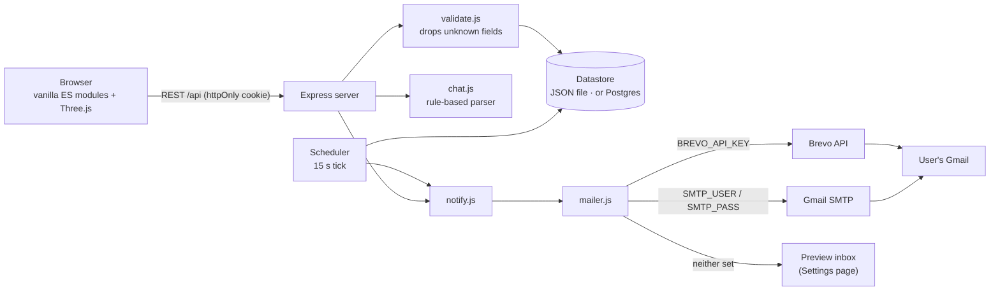
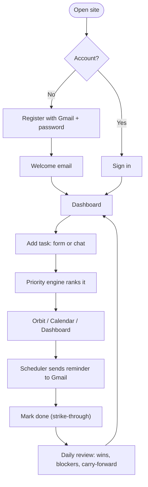
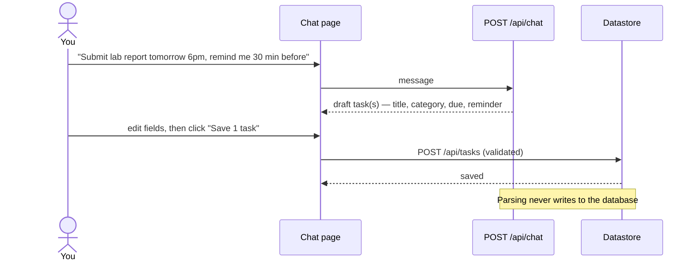
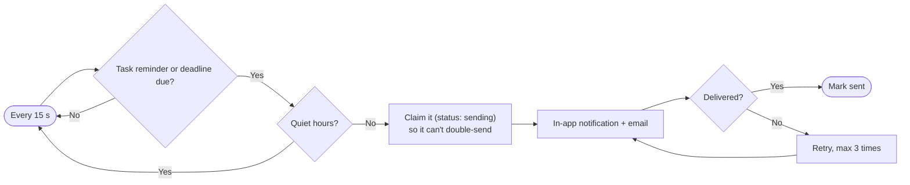

<div align="center">

# 🪐 Astreoid

**A 3D personal assistant for tasks, study, projects and habits — your open tasks orbit you as asteroids, and reminders land in your Gmail.**


[Features](#-features) · [Tour](#-tour-click-to-expand) · [How it works](#-how-it-works) · [Quick start](#-quick-start) · [Deploy free](#-deploy-free-no-computer-needed) · [Config](#-configuration) · [API](#-api) · [Security](#-security) · [Troubleshooting](#-troubleshooting)

</div>

---

## ✨ Features

| | |
|---|---|
| 🔐 **Gmail accounts** | Register and sign in with a Gmail address + password. Every notification is emailed to that address. |
| ✅ **Tasks** | Create, edit, search, filter, sort, complete (with a strike-through animation) and delete. Categories: academics, coding, project, personal, habit. |
| 🧠 **Recommendations** | A deterministic priority engine ranks tasks by deadline, priority and dependencies. It *suggests* — nothing is scheduled unless you accept. |
| 💬 **Chat to task** | Type "Submit physics lab report tomorrow 6pm, remind me 30 minutes before". You get an **editable preview**, and only a confirmed draft is saved. |
| 📅 **Calendar planner** | Month view, hourly day planner, weekly fixed commitments, drag-and-drop scheduling of unscheduled tasks. |
| 🎓 **Academics** | Subjects with exam dates and revision topics, plus a progress bar per subject. |
| 💻 **Projects** | Projects with milestones, due dates and linked tasks. |
| 🔁 **Habits & goals** | Daily habit check-ins with streaks, and goals with a progress slider. |
| 📝 **Daily review** | Wins, blockers, notes, carry-forward of unfinished tasks, and an emailed summary. |
| 🔔 **Reminders** | A server-side scheduler emails reminders, deadline alerts (1 h before / overdue) and a morning briefing, even with the browser closed. It respects quiet hours and never double-sends. |
| 🪐 **Orbit (3D)** | Open tasks circle a sun as clickable asteroids: closer ring = more urgent, bigger = higher priority, colour = category. |
| 📈 **Weekly momentum** | Dashboard card with 7 days / 1 month / 6 months / 1 year ranges; the title and chart change with the range. |
| 🌗 **Day / night** | One toggle themes the whole app and the 3D scene. |

---

## 🖼️ Tour (click to expand)

<details open>
<summary><b>1 · Login / Register</b> — drag the asteroid to spin it</summary>
<br>


- Sign-ups are limited to Gmail addresses (configurable with `ALLOWED_EMAIL_DOMAINS`).
- Passwords need 8+ characters with a letter and a number, and they are stored as bcrypt hashes.
- A welcome email is sent on registration.
</details>

<details>
<summary><b>2 · Dashboard</b> — night and day</summary>
<br>


- **Next recommended task** with *Start now*, *Mark done* and *Add to my plan*.
- **Today's priorities**, with overdue and due-soon chips.
- **Weekly momentum** with a range dropdown; the card follows the theme.
- **Quick actions** open chat or the planner.
</details>

<details>
<summary><b>3 · Orbit</b> — your tasks as a solar system</summary>
<br>


Drag to rotate and scroll to zoom. Rings run from inner to outer: **overdue → today → 3 days → this week → later**.
</details>

<details>
<summary><b>4 · Chat assistant</b> — plain English → preview → confirm</summary>
<br>


Try these:
- `Tomorrow I need to revise DBMS for 2 hours and submit the lab record by 5 PM`
- `Remind me to call the lab TA tomorrow at 4 pm`
- `What should I do next?`, `What's due?`, `Plan my day`
</details>

<details>
<summary><b>5 · Tasks</b></summary>
<br>


Search, filter by status or category, and sort by priority or due date. Completing a task draws a strike-through before the row updates.
</details>

<details>
<summary><b>6 · Calendar</b></summary>
<br>


Drag a task from *Unscheduled* onto a day or hour. "Plan my day" only proposes a schedule, and you apply it.
</details>

<details>
<summary><b>7 · Study, Code, Habits, Review, Settings</b></summary>
<br>

**Study**


**Code**


**Habits & goals**


**Daily review**


**Settings** — time zone, day hours, quiet hours, notification switches, password, delete account and the email inbox preview

</details>

---

## 🔄 How it works

### Architecture


### User journey


### Chat → task (nothing is saved without your confirmation)


### Reminder pipeline


<details>
<summary><b>Data model</b></summary>

Every record lives under `data[userId][collection]`, so a user can only reach their own records.

| Collection | Main fields |
|---|---|
| `tasks` | title, description, category, priority, status, dueAt, estimatedMinutes, scheduledStart/End, subject, projectId, dependsOn, remindAt |
| `subjects` | name, examDate, topics[{title, done}], notes |
| `projects` | name, description, milestones[{title, done, due}] |
| `habits` | title, log[YYYY-MM-DD…] |
| `goals` | title, progress 0–100, due |
| `events` | title, date, startTime, endTime, repeat (none / weekly) |
| `reviews` | date, wins, blockers, notes, completed/unfinished task ids |
</details>

<details>
<summary><b>Project structure</b></summary>

```
astreoid/
├─ server/
│  ├─ index.js        Express app, auth, generic CRUD, routes
│  ├─ db.js           JSON-file store, or Postgres when DATABASE_URL is set
│  ├─ validate.js     per-collection schemas (unknown fields dropped)
│  ├─ chat.js         chat → task draft parser
│  ├─ scheduler.js    reminders, deadline alerts, morning briefing
│  ├─ notify.js       in-app + email notifications (respects prefs)
│  ├─ mailer.js       Brevo API / SMTP / preview inbox
│  ├─ templates.js    HTML emails
│  └─ env.js          .env loader
├─ shared/            tz.js, priority.js (used by server and browser)
├─ public/
│  ├─ index.html
│  ├─ css/            app.css, components.css (Uiverse), tailwind.css (built)
│  └─ js/             main.js, scene.js (Three.js), ui.js, api.js, store.js, common.js
│     └─ pages/       dashboard, orbit, chat, tasks, calendar, academics, projects, habits, review, settings
├─ test/api.test.js   24 end-to-end API checks
├─ render.yaml        Render blueprint
└─ docs/screenshots/
```
</details>

---

## 🚀 Quick start

Requires Node 22+.

```bash
npm install
cp .env.example .env     # optional — see Configuration
npm start                # http://localhost:3000
npm test                 # 24 API checks
```

- **Windows PowerShell:** use `copy .env.example .env`.
- After editing Tailwind classes, run `npm run build:css`.
- With no email settings, the app runs in **preview mode**. Emails are saved and shown under **Settings → Email delivery**, so every flow can be tried.

---

## ☁️ Deploy free (no computer needed)

Stack: **Render** (web service) + **Neon** (Postgres) + **Brevo** (email API). Render's free plan blocks SMTP ports, which is why email goes through Brevo's HTTPS API. Free-tier limits change, so check each site's current terms.

<details open>
<summary><b>Step-by-step</b></summary>

1. **GitHub.** Create a repo and upload the project *without* `node_modules`, `data` and `.env`. In File Explorer, open the project folder, press `Ctrl+A`, and drag everything into **Add file → Upload files**.
2. **Neon.** Create a project with only *Postgres* switched on. Click **Connect**, copy the `postgresql://…` string and delete `&channel_binding=require` if it is there. This is your `DATABASE_URL`.
3. **Brevo.** Sign up, verify your phone, then open **Senders → Add a sender** and verify your Gmail. Under **SMTP & API → API Keys**, generate a key. This is your `BREVO_API_KEY`.
4. **Render.** Choose **New → Blueprint** and pick the repo. Render reads `render.yaml` and asks for four values:

   | Key | Value |
   |---|---|
   | `DATABASE_URL` | the Neon string |
   | `BREVO_API_KEY` | the Brevo key |
   | `MAIL_FROM` | `Astreoid <yourgmail@gmail.com>` (the verified sender) |
   | `APP_URL` | `https://<your-service>.onrender.com` |

5. Wait for **Live**, then open the URL and register.
6. **Keep it awake (optional).** Free web services sleep after about 15 minutes without traffic, and reminders can't run while asleep. A free monitor (for example UptimeRobot) that requests `/healthz` every 5 minutes keeps it up.
</details>

> ⚠️ Never commit or post `DATABASE_URL`, `BREVO_API_KEY` or `SMTP_PASS`. If one leaks, rotate it. Reset the Neon password or delete the Brevo key.

---

## ⚙️ Configuration

| Variable | Purpose | Default |
|---|---|---|
| `PORT` | HTTP port | `3000` |
| `APP_URL` | Public URL used in emails | `http://localhost:3000` |
| `DATABASE_URL` | Postgres connection string; unset = local `data/db.json` | — |
| `BREVO_API_KEY` | Send mail via Brevo's HTTPS API | — |
| `MAIL_FROM` | Sender, e.g. `Astreoid <you@gmail.com>` (must be verified in Brevo) | — |
| `SMTP_HOST` / `SMTP_PORT` / `SMTP_SECURE` | SMTP server | `smtp.gmail.com` / `465` / `true` |
| `SMTP_USER` / `SMTP_PASS` | SMTP login (Gmail **App Password**) | — |
| `ALLOWED_EMAIL_DOMAINS` | Sign-up allow-list; empty = any | `gmail.com,googlemail.com` |
| `JWT_SECRET` | Cookie signing secret | auto-generated and stored |
| `NODE_ENV` | `production` makes cookies `Secure` | — |
| `TRUST_PROXY` | `true` behind Render, Caddy or nginx | — |
| `DATA_DIR` | Folder for local JSON data | `./data` |
| `SCHEDULER_MS` | Scheduler tick | `15000` |

**Email mode priority:** `BREVO_API_KEY` → SMTP → preview inbox.

---

## 🔌 API

All routes need the session cookie, except register, login and `/healthz`.

| Method | Route | Description |
|---|---|---|
| POST | `/api/register` · `/api/login` · `/api/logout` | Account session |
| GET | `/api/me` | Current user and mail mode |
| PUT | `/api/prefs` | Time zone, quiet hours, notification switches |
| POST | `/api/password` | Change password |
| DELETE | `/api/account` | Delete account and data |
| GET · POST · PUT · DELETE | `/api/{tasks,subjects,projects,habits,goals,events,reviews}` | CRUD for your own records |
| POST | `/api/chat` | Parse text into draft tasks; also recommend, plan, summary |
| GET | `/api/reminders` | Upcoming reminders |
| GET · POST | `/api/notifications` · `/read` · `/test` | In-app notifications and a test email |
| GET | `/api/outbox` | Preview-mode inbox |
| POST | `/api/reviews/:date/email` | Email a daily review |
| GET | `/healthz` | Health check |

---

## 🔒 Security

- bcrypt password hashes, and an httpOnly, SameSite=Lax session cookie (`Secure` in production).
- Login throttling, and an Origin check on every write.
- Schema validation drops unknown fields, so clients can't set `ownerId` or server flags.
- Per-user data isolation, enforced on the server for every collection.
- Headers: `X-Content-Type-Options`, `X-Frame-Options: DENY`, `Referrer-Policy`.
- **Not included:** email confirmation on sign-up, forgot-password, a Content-Security-Policy and FCM background push. These would be good additions before wide public use.

---

## 🧰 Troubleshooting

<details>
<summary><b>Emails don't arrive</b></summary>

- Check **Settings → Email delivery**. "Preview mode" means no email provider is configured.
- With Brevo, `MAIL_FROM` must use the exact address you verified under Senders, and the phone verification must be finished.
- Look in Gmail's Spam folder.
- Check the Render **Logs** for `Brevo 4xx` errors.
</details>

<details>
<summary><b>Reminders are late on Render's free plan</b></summary>

The service sleeps when idle. Add an uptime monitor for `/healthz` (see Deploy, step 6).
</details>

<details>
<summary><b>"Startup failed: connect …"</b></summary>

`DATABASE_URL` is wrong. Paste only the `postgresql://…?sslmode=require` part, with no quotes and no `psql` prefix.
</details>

<details>
<summary><b>GitHub says "Try uploading fewer than 100 files"</b></summary>

You are uploading `node_modules`. Upload only the 51-file project folder, or use `git add .` with the included `.gitignore`.
</details>

<details>
<summary><b>`TRUST_PROXY=true` gives a PowerShell error</b></summary>

It belongs in `.env` (or Render's Environment tab), not in the terminal.
</details>

---

## 🙏 Credits

UI components are adapted from [Uiverse.io](https://uiverse.io) and credited at the top of `public/css/components.css`. 3D by [Three.js](https://threejs.org). Built by [RaghuramReddy205](https://github.com/RaghuramReddy205).
